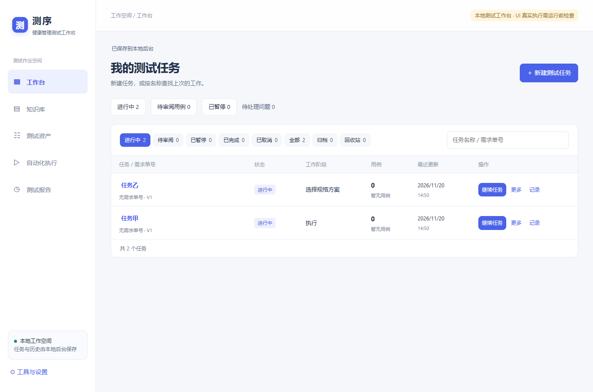
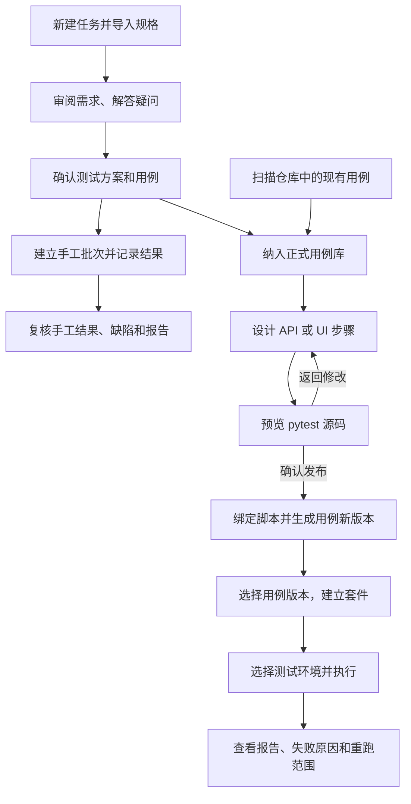
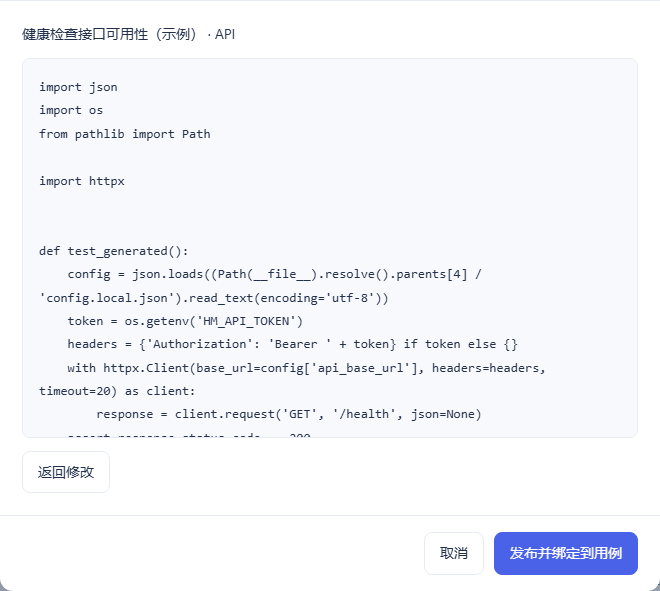
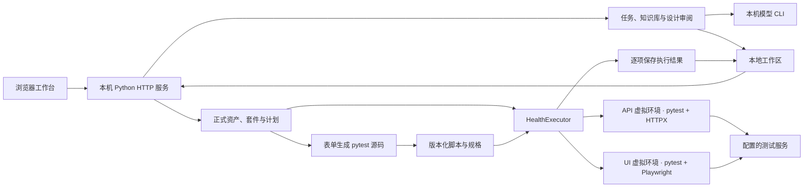

# 健康管理云服务端到端测试工作台

这套工作台供测试人员在浏览器里完成需求审阅、用例设计、API/UI 自动化编码、套件执行和报告复核。工作台在本机运行。团队通过 Git 共享框架和测试源码，每台电脑独立保存任务、资产版本、执行历史和测试环境配置。

**第一次使用**可以直接启动空白工作台，或运行随仓库提供的合成服务联调测试。**接入真实产品**时，再填写测试地址、接口路径和页面标题。仓库目前包含 API 健康检查和 UI 首页冒烟两个产品用例。建档、指标录入、评估和随访的业务规则仍待确认。[产品接入与验收清单](docs/acceptance.md)



## 在新电脑启动

推荐使用 Windows、PowerShell、Git 和 Python 3.12。首次安装会下载 Python 依赖和 Playwright Chromium。从仓库根目录运行后续命令。

```powershell
git clone https://github.com/c903648678-sys/healthmanager-autotest.git
cd healthmanager-autotest
$env:PYTHONUTF8 = "1"
python scripts/bootstrap.py
python scripts/run.py doctor
python -m workbench.server --open
```

浏览器打开 [本机工作台](http://127.0.0.1:8878/) 后即可新建任务。安装脚本分别创建 API 和 UI 的虚拟环境，启动工作台无需手动激活它们。以后可直接双击 [start-workbench.cmd](start-workbench.cmd)。如本机端口已被其他应用占用，可运行 `python -m workbench.server --port 8879 --open`。

## 从规格到测试报告



| 当前要做的事 | 操作入口与结果 |
| --- | --- |
| 从一份新需求开始 | 在首页新建任务，导入规格。依次审阅需求疑问、覆盖方案和候选用例，确认后纳入正式用例库。AI 设计使用本机已安装并登录的 Codex 或 Claude CLI，选中的资料会提交给所选模型服务。 |
| 从现有脚本开始 | 在测试资产中刷新脚本目录，将扫描到的 API 或 UI 冒烟用例纳入正式库。已有绑定可直接用于组套。 |
| 把设计转成代码 | 首页选择「实现自动化」，在正式用例库找到目标用例，点击「设计并生成脚本」。按下面的示例填写表单。此步骤通过本地模板生成源码。 |
| 准备执行 | 在「自动化执行 → 环境」配置测试环境，在套件中选择同一产品、同一类型的用例版本。可直接运行套件，也可通过执行计划复用版本和环境。 |
| 复核结果 | 在运行详情或「测试报告」中核对用例、环境、结果与耗时。失败或未执行项可从原运行发起重跑。手工批次另行记录执行人填写的实际结果。 |

### API 示例：生成健康检查脚本

假设测试服务约定 `GET /health` 返回 HTTP 200，响应体为 `{"ready":true}`。这是用于说明表单的合成契约，请用实际接口定义替换。

| 表单字段 | 示例 | 脚本的行为 |
| --- | --- | --- |
| HTTP 方法、接口相对路径 | `GET`、`/health` | 使用环境中的 API 基础地址发送请求。支持 GET、POST、PUT、PATCH 和 DELETE。 |
| 请求 JSON | 留空 | 带请求体的接口可填写合成 JSON。 |
| 预期 HTTP 状态码 | `200` | 断言响应状态码相等。 |
| 预期响应字段 | `{"ready": true}` | 逐项核对 JSON 对象的顶层字段，允许存在其他字段。填 `{}` 时只核对状态码。 |

点击「生成代码预览」即可检查实际要运行的 Python。可以返回修改；点击「发布并绑定到用例」后生成脚本文件和新的资产版本。已有套件继续引用原先选定的版本。要运行刚发布的代码，请新建或更新套件并选中新版。



### UI 示例：填写记录并验证保存提示

假设合成页面 `/records/new` 有三个稳定的 `data-testid`，分别为 `record-name`、`save` 和 `result`。在 UI 用例的设计表单填入该路径，并将以下 JSON 粘贴到「按顺序操作」。

```json
[
  {"action": "fill", "testId": "record-name", "value": "合成记录 A"},
  {"action": "click", "testId": "save"}
]
```

在断言元素的 test ID 中填写 `result`，预期文本填写 `保存成功`。生成的 Playwright 用例会填写输入框、点击按钮，再等待目标元素文本匹配。检查首页标题时，操作列表可填 `[]`，断言元素留空，预期文本填写页面标题。表单支持最多 30 个点击或填写步骤。需要跨 API/UI 准备数据、回读和清理时，可参考现成的[合成记录闭环测试](ui/tests/framework/test_record_flow.py)。

## 测试环境与数据

通过界面保存环境后，配置存放在仓库根目录的 `config.local.json`。也可从 [config.example.json](config.example.json) 复制一份手工填写。初始模板只预填环境名。可以只接入 API 或只接入 UI。

| 字段 | 何时填写 | 用途 |
| --- | --- | --- |
| `environment` | 配置环境时 | 套件执行时选择的环境名，默认 `test`。 |
| `api_base_url`、`health_path` | 执行 API 时 | API 服务的 HTTP(S) 地址和以单个 `/` 开头的健康检查路径。 |
| `base_url`、`expected_title` | 执行 UI 时 | 浏览器访问的产品地址和首页冒烟预期标题。 |

API 支持从执行进程的 `HM_API_TOKEN` 环境变量读取可选 Bearer 凭据。需要凭据时，从已设置变量的终端启动工作台。表单、源码和运行资产应使用合成数据。产品登录、验证码和登录态复用需按实际产品接入。执行器当前串行执行，支持取消和重跑，单条脚本超时上限为 600 秒。

## 验证安装与理解结果

尚无产品环境时，可用下面三条命令验证交付内容。前两条检查依赖和框架；第三条专门检查工作台。命令均在仓库根目录执行。

```powershell
python scripts/run.py doctor
python scripts/run.py verify
.\ui\.venv\Scripts\python.exe -m pytest workbench -q --junitxml=outputs/workbench/verify.xml
```

| 验证范围 | 实际检查内容 | 结果位置 |
| --- | --- | --- |
| API 框架 | 客户端行为及环境预检 | `outputs/api/verify.xml` |
| UI 框架 | Chromium 启动、本机合成服务上的 API 创建 → 浏览器修改 → API 回读 → 清理 | `outputs/ui/verify.xml` |
| 工作台 | 任务和资产管理、代码预览与发布、真实 pytest 子进程、结果归并与恢复 | `outputs/workbench/verify.xml` |
| 产品冒烟 | 配置环境后执行内置健康检查或首页标题用例 | CLI 写入 `outputs/<工程>/product.xml`；从工作台发起的运行在界面查看 |

若只想验证脚本生成链路，运行以下测试即可。它会创建临时工作台和本机 HTTP 服务，分别发布 API/UI 脚本，执行套件并检查报告。结束后清理临时数据。

```powershell
.\ui\.venv\Scripts\python.exe -m pytest workbench/test_codegen.py -q
```

接入真实环境后，可运行 `python scripts/run.py product --project api` 或 `python scripts/run.py product --project ui`。省略 `--project` 会预检并执行两个工程。命令行产品测试默认跳过历史生成目录；已发布脚本按工作台套件固定的版本执行。GitHub Actions 在 Windows 上独立运行 API、UI 和工作台三组检查，并分别上传 JUnit 报告。[CI 配置](.github/workflows/verify.yml)

## 系统架构与开发入口



| 修改目标 | 从哪里读起 |
| --- | --- |
| 页面和 HTTP 路由 | [前端目录](docs/test-workbench/demo/) 是实际运行的界面；[server.py](workbench/server.py) 提供静态资源和工作台接口。 |
| 需求分析、方案与用例审阅 | [jobs.py](workbench/jobs.py)、[contracts.py](workbench/contracts.py)、[providers.py](workbench/providers.py) 以及[共享专家定义](experts/)。 |
| 扫描、脚本生成与套件执行 | [扫描器](workbench/ui_inventory.py)、[代码生成器](workbench/codegen.py)、[资产与套件](workbench/automation.py)、[健康管理执行器](workbench/health_execution.py)。 |
| 添加产品用例 | 参考 [API 健康检查](api/testcases/health/) 或 [UI 首页冒烟](ui/testcases/home/)，在同一目录维护 `case_spec.json` 和 `test_main.py`。 |
| 让后续模型接手 | 从 [AGENTS.md](AGENTS.md) 了解开发约定和回归入口，再按任务阅读对应模块。[工作台迁移记录](docs/workbench-migration.md) 说明代码来源和历史决策。 |

## 知识库资料放在哪里

正式资料在仓库根目录的 [knowledge/](knowledge/) 统一维护。下面的两个共享目录会随 Git 克隆；首次打开时为空。将 UTF-8 编码的 Markdown 或 TXT 放入相应目录，在工作台知识库刷新本地目录后即可审阅和引用。单份文件上限为 200 KB。

| 路径 | 存放内容 |
| --- | --- |
| `knowledge/product/<模块>/<特性>/` | 产品需求、业务规则、接口或页面契约。模块名和特性名随实际产品确定。 |
| `knowledge/testing/<主题>/` | 团队共享的测试方法、数据约定和验收规范。 |
| `.local/workbench/knowledge/notes/` | 本机测试笔记和从执行反馈采纳的知识。 |
| `.local/workbench/knowledge/` | 本机扫描索引、审阅历史及分类信息。通过界面导入的正文保存在 organization.json；需要团队共享时，将正式原文放入上面的共享目录并提交。 |

## 换电脑时带哪些内容

| 内容 | 迁移方式 |
| --- | --- |
| 框架、内置用例与文档 | 在新电脑克隆仓库或拉取最新提交。重新运行安装脚本创建虚拟环境。 |
| 任务、知识库、资产版本、批次和报告 | 在两台电脑均已停止工作台且没有执行任务时，将旧仓的 `.local/workbench/` 私下复制到新克隆的同名空目录。目标已有资料时先备份。 |
| 已发布的生成脚本 | 同时迁移 `api/testcases/_generated/` 和 `ui/testcases/_generated/` 中实际存在的目录，保留原相对路径和文件内容。工作台按路径和摘要核对版本。 |
| 产品环境和身份 | 在新电脑重新填写环境，按需设置 `HM_API_TOKEN`，并登录所选的模型 CLI。 |

## 常见问题

| 现象 | 处理方式 |
| --- | --- |
| 能打开工作台，但无法选择执行环境 | 在「自动化执行 → 环境」填写对应工程的完整字段。只运行框架自检时可直接使用 `verify`。 |
| 「实现自动化」中没有可设计的用例 | 先确认设计用例并纳入正式库，或扫描并纳入现有冒烟用例。对 API 或 UI 类型的正式用例打开「设计并生成脚本」。 |
| 发布了新脚本，运行仍使用旧代码 | 检查套件固定的用例版本，然后更新套件。若从计划启动，再核对计划引用的套件版本。 |
| 报告中出现「阻断」或「未执行」 | 查看首条阻断原因，核对环境、绑定和脚本摘要。已经完成的用例保留原结果，修正问题后按报告范围重跑。 |
| 浏览器启动失败或提示缺少 Chromium | 在仓库根目录运行 `python scripts/bootstrap.py --project ui`，再运行 `python scripts/run.py verify --project ui` 单独验证。 |

### 执行快照与旧套件升级

工作台在接受运行时固定本批次使用的公开环境配置。运行详情显示当时的服务地址；运行中修改环境只影响后续新启动的批次。各用例使用临时工程副本中的配置，兼容按相对路径读取配置的旧脚本。运行仍会核对正式绑定的文件，内容变化会阻断执行。

新生成的 API 脚本逐层区分 JSON 布尔值和数值，例如预期 true 时返回 1 会失败。新生成的 UI 脚本默认要求主文档返回 2xx，再检查元素或标题。专门验证错误页时，在 UI 表单填写预期状态码，例如 503。

要把新断言用于已有用例，在正式用例库选择「设计并生成脚本」，复核原表单并发布新版本，再更新套件及引用它的计划。历史脚本和历史套件仍按原断言执行。Git 对绑定的 Python 和 JSON 固定使用 LF；执行器也识别旧版在 CRLF 或 LF 文件上生成的摘要。
